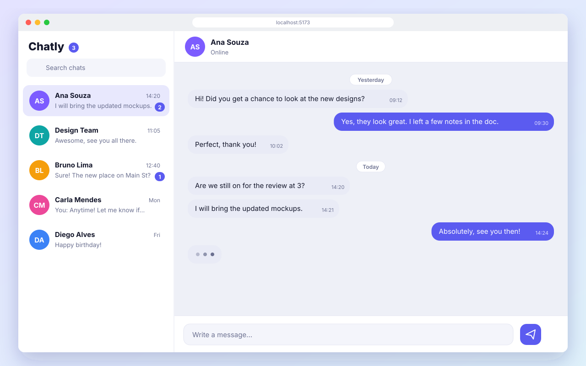

<p align="center">
  
</p>
<p align="center"><sub>Preview: design illustration of the chat screen (light theme).</sub></p>

# Chatly: React Chat UI

A modern, free chat and messaging interface built with **React 18**, **TypeScript** and **Vite**. No UI library and no backend: everything runs in the browser, so it is easy to read, restyle and connect to your own API.

## Features

- **Conversation list** with avatars, last message preview, time and unread badges
- **Live search** across names and message text
- **Message thread** with day separators (Today, Yesterday, dates) and timestamps
- **Composer** that sends on Enter and ignores blank messages
- **Typing indicator** and a simulated reply, so the demo feels alive
- **Persistence**: chats are saved in the browser (localStorage)
- Light and dark themes, remembered between visits, no flash on load
- Responsive: two panes on desktop, list and thread screens on mobile
- Accessible: labelled controls, live region for new messages, focus styles
- All chat logic lives in plain functions with unit tests

## Quick start

```bash
git clone https://github.com/lenivalestevao/react-chat-ui.git
cd react-chat-ui
npm install
npm run dev
```

| Command | What it does |
| --- | --- |
| `npm run build` | Type-check and create a production build in `dist/` |
| `npm run preview` | Serve the production build locally |
| `npm test` | Run the unit tests (Vitest) |
| `npm run typecheck` | TypeScript check only |

## Project structure

```
src/
  App.tsx                 State, persistence and the simulated reply
  styles.css              Design tokens (light and dark) and all styles
  components/
    Sidebar.tsx           Search and conversation list
    Thread.tsx            Header, messages and composer
    Icon.tsx              Inline SVG icons
  data/seed.ts            Demo conversations and canned replies
  lib/
    chat.ts               Filter, sort, group by day, send, unread, preview
    chat.test.ts          Unit tests
    theme.ts              Theme hook with persistence
```

## Make it yours

- **Real backend**: replace the `setTimeout` reply in `App.tsx` with your API or WebSocket and call `sendMessage` when a message arrives.
- **Demo data**: edit `src/data/seed.ts`. Delete the `chatly-state` key in localStorage to reset the demo.
- **Colors**: change the CSS variables at the top of `src/styles.css`.
- **Brand**: rename "Chatly" in `index.html` and `Sidebar.tsx`.

## License

MIT. Free for personal and commercial use.
